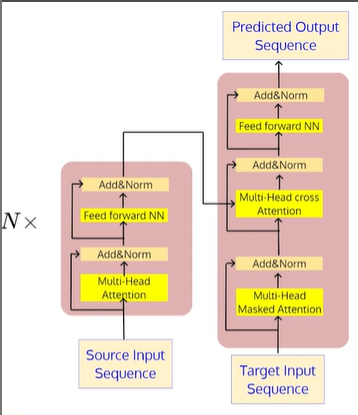
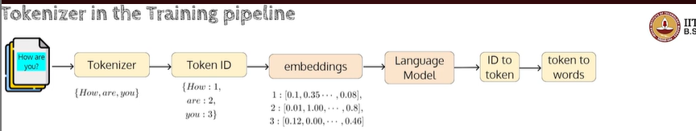

- https://youtu.be/M5UPDAaISHg

- Transformer is a simple `encoder-decoder model` with attention mechanism at its core.

- Recall that the transformer is a simple encoder-decoder model with attention mechanism at its core

- The input is a sequence of words in the source
language

    - `I am reading a book`

- The output is also a sequence of words in the target language

    - `Naan oru puthagathai padiththu kondirukiren`

- The lengths of the input and output sequences need not be the same

- 

- The tokenizer simply splits the input sequence into tokens.simple approach is to use whitespace for splitting the text.
- Each token is associated with a unique ID.
- Each ID is associated with a unique embedding vector.
- The model then takes these embeddings and predicts token !Ds.
- During inference, the predicted token IDs are converted back to tokens (and then to words).
- The tokenizer essentially contains two components: the encoder, which converts input word (token) to a token id, and the decoder, which performs the reverse operation.
- The size of the vocabulary determines the size of the embedding table 
- The question then is how do we build (learn) a vocabulary V from a large corpus that contains billions of sentences?

- We can split the text into words using whitespace (now called pre-tokenization) and add all unique words in the corpus to the vocbulary.

- We also include special tokens such as `<go>,<stop>,< mask> ,< sep> ,< cls>` and others to the
vocabulary based on the type of downstream tasks and the architecture (GPT/BERT) choice