- https://www.youtube.com/watch?v=yEcEzyaQB5c
# Byte Pair Encoding

## Wishlist
    - we need a tokenizer
    - step 1:
        - its not all the words in dataset :` Enjoyed, enjoy,enjoying.`
            - small sequence but large vocabulary
        - its not all characters
            - small vocabulary, but large sequence
        - its a `sub-word`
            - intermediate

    - Efficiently handle unknown words during inference

    - Be language agnostic

## General pre-processing steps in a language model
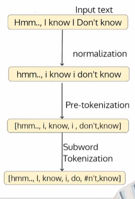

- The tokenization schemes follow a sequence of
steps to learn the vocabulary.
- The input text corpus is often built by scraping web
pages and ebooks.
    - First the text is normalized, which involves operations such as treating cases, removing accents, eliminating multiple whitespaces, handling HTML tags, etc.
    - Splitting the text by whitespace was traditionally called tokenization. However, when it is used with a sub-word  tokenization algorithm, it is called pre-tokenization.
    - Learn the vocabulary (called training) using these
words

- 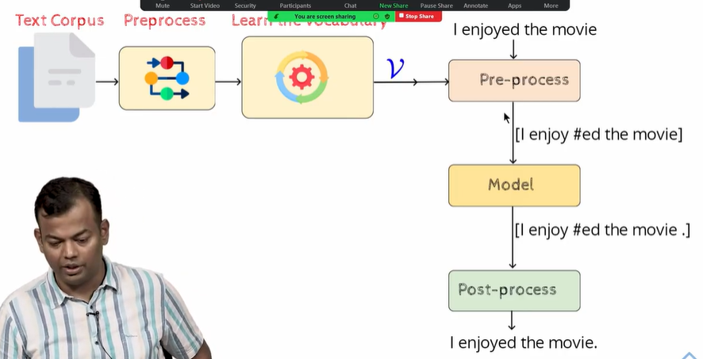

code
```python
import re, collections

def get_stats (vocab) :
    pairs = collections.defaultdict (int)
    for word, freq in vocab.items () :
        symbols = word.split ()
        for i in range(len(symbols)k1):
            pairs[symbols[i], symbols[i+1]] += freq
    return pairs

def merge_vocab(pair, v_in):
    v_out = ()
    bigram = re.escape(' '.join (pair) )
    p = re.compile(r' ( ?<! \S) ' + bigram + r' ( ?! \S) ')
    for word in v_in:
        w_out = p.sub(''.join (pair), word)
        v_out [w_out] = v_in [word]
    return v_out

vocab = ('l o w </w>' : 5, 'l o we r </w>' : 2,
'n e w e s t </w>' :6, 'w i d e s t </w>':3)
num_merges = 10

for i in range(num_merges) :
    pairs = get_stats (vocab)
    best = max(pairs, key=pairs.get)
    vocab = merge_vocab (best, vocab)
print (best)
```


### Algorithm

    - Start with a dictionary that contains words and their count

    - Append a special symbol </w> at the end of each word in the dictionary

    - Set required number of merges (a
    hyperparameter)

    - Initialize the character-frequency
    table (a base vocabulary)

    - Get the frequency count for a pair of
    characters

    - Merge pairs with maximum
    occurrence


### Example
     - 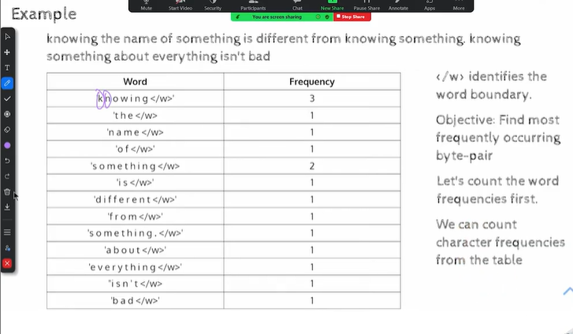
     - the total number of unique words in this toy example is less, here 13, but in reality this can be 1 million aswell.
     - so we dont want to start from there
     - we start ,init vocab size as unique characters.
     - 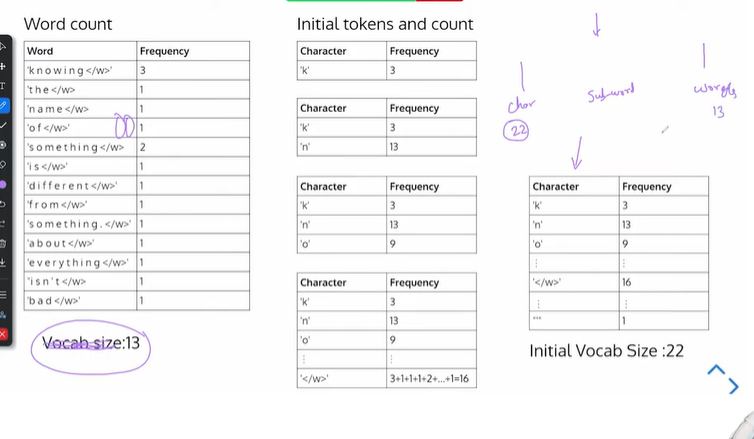
     - 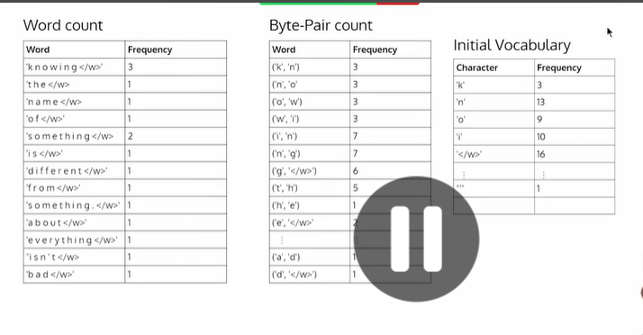
     - now we will look at character pairs and thier frequency

     - take the pair with max frequencey, if tie take the first one, and add this pair to the vocab.
     - 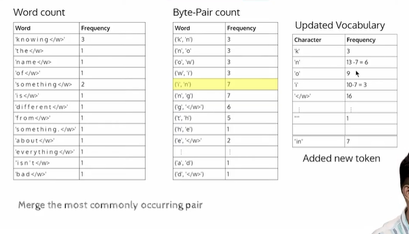
     - 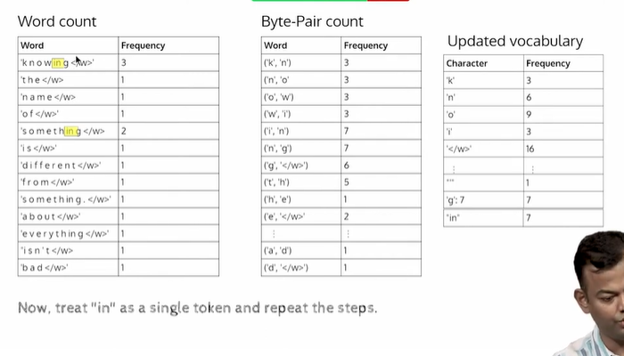
     

- keep repeating, and now how many times will we be doing this?
    - when we do bpe operation, we specify the number of merge operations -> 32k => init vocab +32k. which would be approx to merge operations -> ie final vocabulary size

- 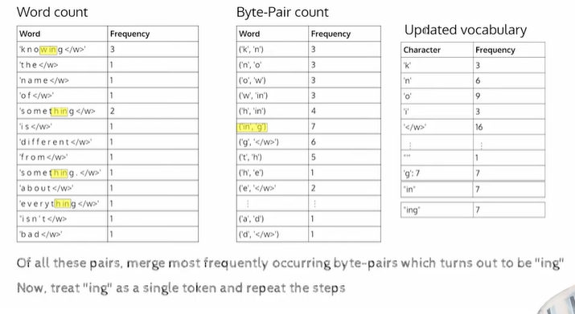
- rule of thumb  , for a single lang 32k will be ok,
- if we use a vocab, what is the fertility rate?
    - knowing -> know + ing => fretility of knowing is 2
    - for all words , compute fertility, if that fertility , get the average.
        - for char based , fert = avg num of chars
    - if we use all the words then fertility will be 1, 


- we need to aim for vocab, between 1 and the avg word len, 
    - 2 is normal
    - 1.5-3 is a good number

- 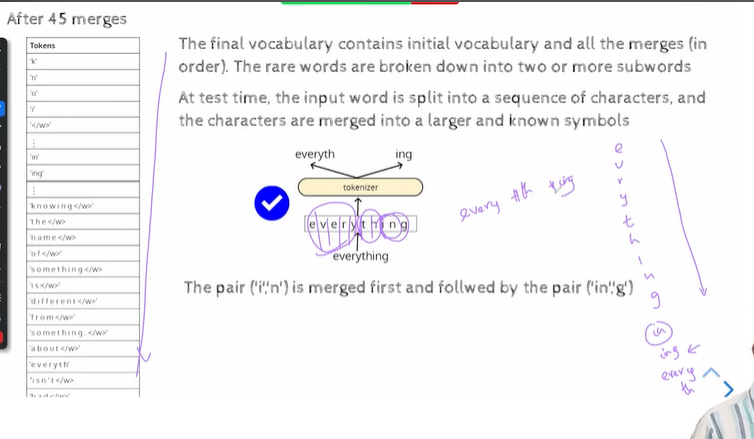

- 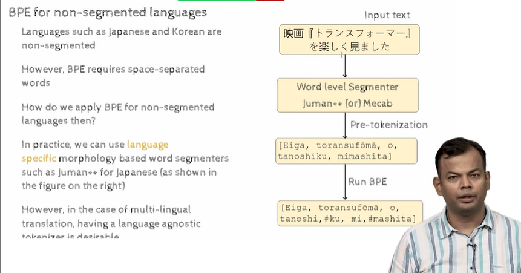
- japanese and korean , no space between words
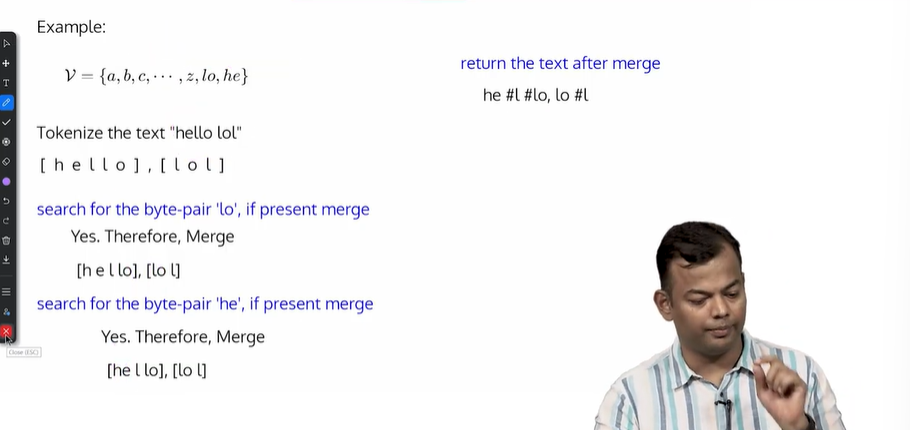
