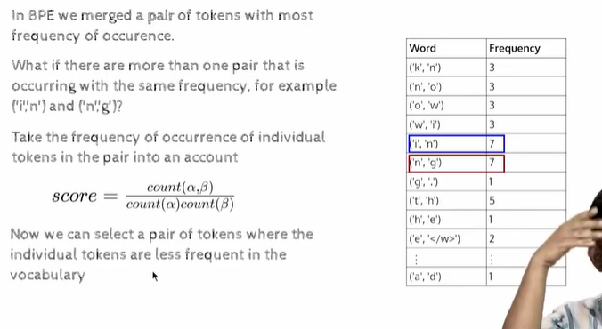
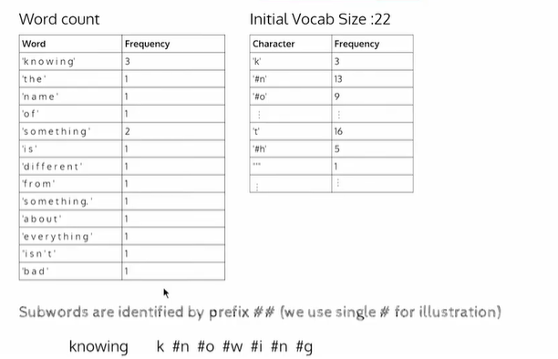
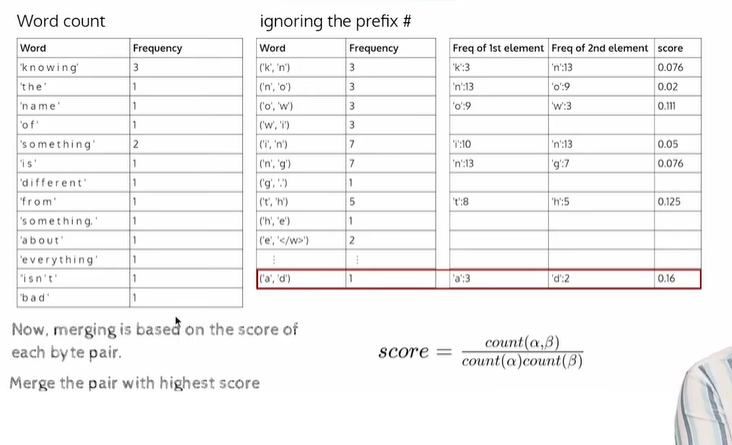
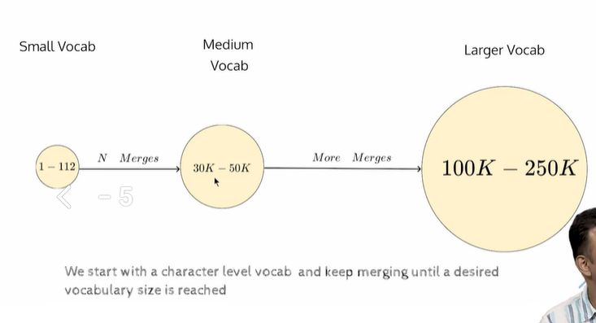
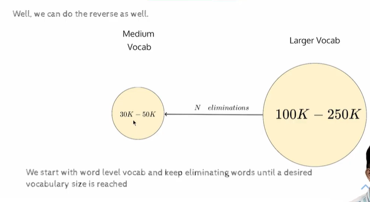

- https://youtu.be/FkKCpGyHEhg

## Word Piece tokenizer

- 
- we start with BPE
    - what we do in case of tie.
        ```
        score=count(a,b)/count(a)*count(b)
        ```
    - take the one with highest score
    - when will the score be high?
        - when the denominator is low.
        - i.e individual tokens didnt appear frequently, 
        - these two token typically appear when they merge together.
    - this is the diff of word-piece from BPE
    - 
    - 
    - 
    - 