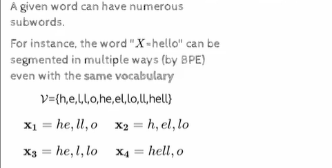
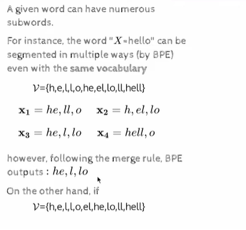
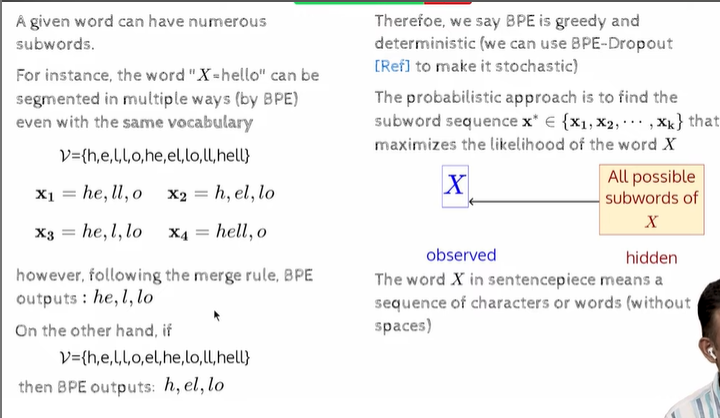
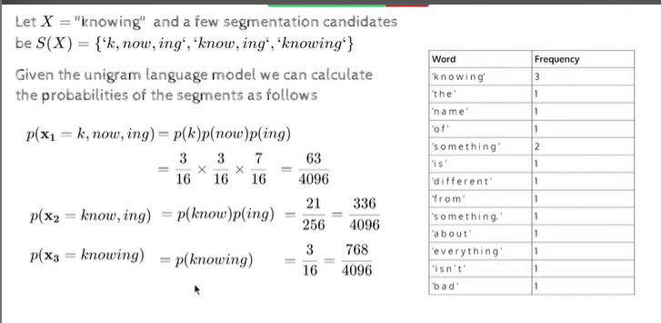
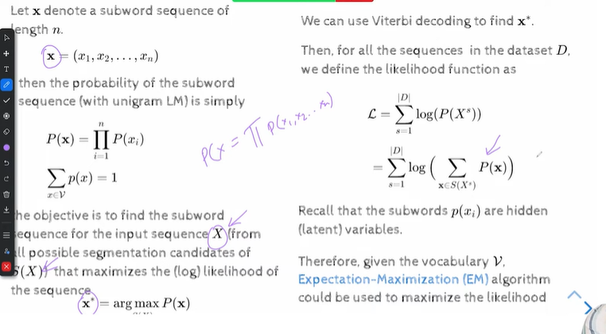
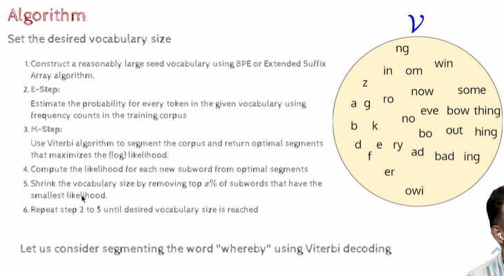
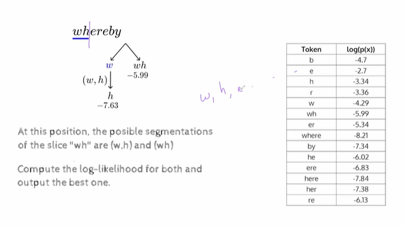
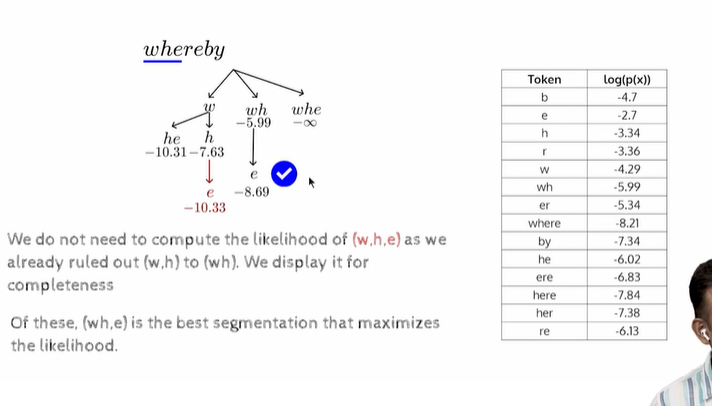
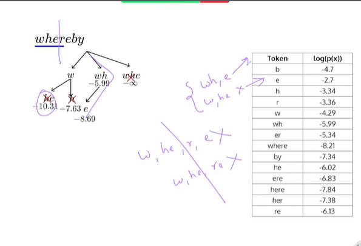

- https://youtu.be/C1aglYTjBX0

## Sentence Piece tokenizer

- same vocabulary, we have multiple merges possible,
    - `he l lo` for the above vocabulary order, we got this as output

- 
    - here the order of the vocab is diff
    - so it give   `h el lo` as output

- a given word can have many segmentations
    - Therefoe, we say BPE is greedy and deterministic (we can use BPE-Dropout [Ref] to make it stochastic)

    - we need a segmentation that maximizes the likelihood of the word.
    - in case of sentence piece , we dont even need to worry about words without spaces, 
    - 

### Example
    - X = "knowing"
    - S(X) is candidate subwords.

- 

- 

### Algorithm

- set a desired vocab size
- Construct a reasonably large seed vocabulary using BPE or Extended Suffix Array algorithm.

- 
- Viterbi algo
- how do we avoid listing down all the segmentations for a given word.
    - eg `whereby`
    - 
    - upto `wh` - the best is `wh` not `w` and `h`
    - so we avoid all segmentations that hav `w,h,e...`
    - in the diagram , the value is log, so `log(m)*log(n)=log(m+n)` => we just add them.
    - we are selecting `wh`

    - `whe` is not a token at all
    - 
    - uptil char 3 , best path is `wh,e` is best. so we skip the rest.

- 

- bpe and word piece starts small , the sentence piece does the opposite.