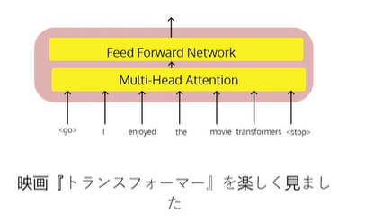
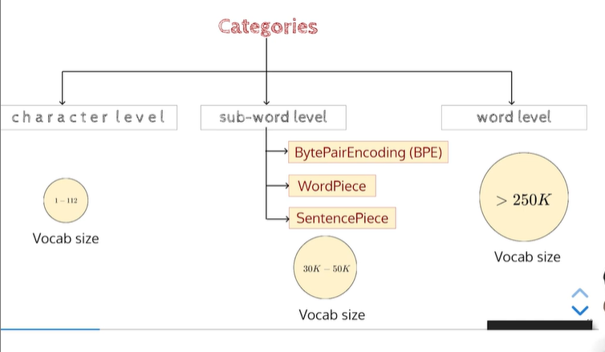
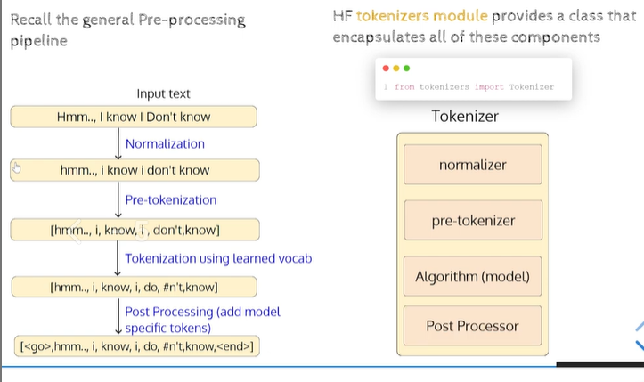
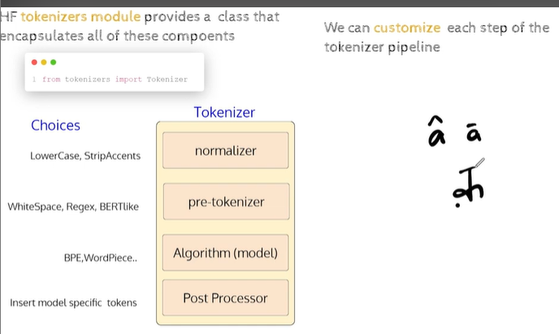
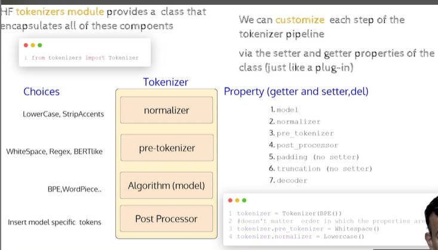
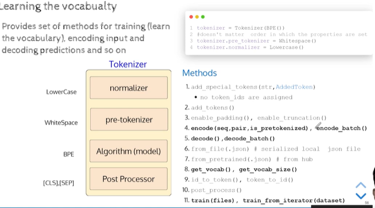
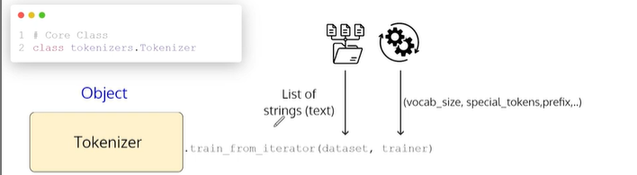

## Hugging face tokenizer.

- Some Questions

- Is spliting the input text into words using
whitespace a good approach?

- If so, do we treat the words "enjoy" and
"enjoyed" as separate tokens?

- What about languages like Japanese, which
do not use any word delimiters like space?

- Why not treat each individual character in a
language as a token in the vocabulary?

- Finally, what are good tokens?


## Challenges in building a vocabulary
    - What should be the size of vocabulary?
        - Larger the size, larger the size of embedding matrix and greater the complexity of computing the softmax probabilities.
        -  What is the optimal size?
    - Out-of-vocabulary
        - If we limit the size of the vocabulary (say, 250K to 50K), then we need a mechanism to handle out-of-vocabulary (OOV) words. How do we handle them?
    - Handling misspelled words in corpus

        - Often, the corpus is built by scraping the web. There are chances of typo/spelling errors. Such erroneous words should not be considered as unique words.

    - Open Vocabulary problem
        - Å new word can be constructed (say,in agglutinative languages) by combining
        existing words . The vocabulary, in principle, is infinite (that is, names,numbers, .. )
        which makes a task like machine translation challenging

## Tokenization algorithms




## HF Tokenizers
    - how to build our own tokenizer.

- 

- 

```python
tokenizer = Tokenizer(BPE())
#doesn't matter order in which the properties ar
tokenizer.pre_tokenizer = Whitespace()
tokenizer.normalizer = Lowercase ()
```




- We `do not` need to call each of these methods sequentially to build a tokenizer
- After setting `Normalizer and Pre-Tokenizer`, we just need to call the train methods to build
the vocabulary

- Once the training is complete, we can call methods such as encode for encoding the input
string

- What should be the output if we call `encode_batch` method?

